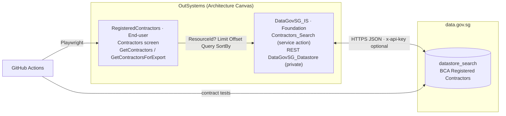
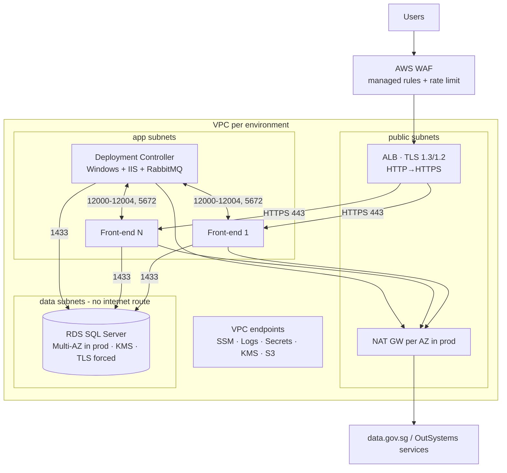

# Registered Contractors Explorer — OutSystems + data.gov.sg

A Reactive Web application built in OutSystems 11. It lets anyone search, sort, page through and
export the **Building and Construction Authority (BCA) register of contractors** (about
24,000 registrations), read live from data.gov.sg. The OutSystems modules live in the
OutSystems environment. This repository holds everything else: the **AWS Infrastructure
as Code** that runs the OutSystems Platform, the **automated tests**, the **CI/CD
pipelines** and the documentation.

| Deliverable | Where |
|---|---|
| OutSystems application: modules `DataGovSG_IS` (integration) and `RegisteredContractors` (screens) | OutSystems environment (access provided separately) |
| AWS IaC for the OutSystems Platform | [`infra/terraform`](infra/terraform) |
| Automated tests | [`tests`](tests), [`infra/terraform/tests`](infra/terraform/tests) |
| CI/CD | [`.github/workflows`](.github/workflows), [`scripts/lifetime_deploy.py`](scripts/lifetime_deploy.py) |
| Design decisions | [`docs/architecture.md`](docs/architecture.md) |

---

## 1. What the application does

**Dataset:** BCA Registered Contractors on data.gov.sg (resource
`d_dcda79be4aded5f9e769b8e23ff69b47`). Each row is one company registration: name, UEN,
workhead (e.g. `CR06`), grade (e.g. `L1`–`L6`, `A1`, `C3`), address and expiry date.

The **Contractors** screen is public and needs no login:

* **Search** across every field (company, street, grade, workhead and so on). Punctuation is
  allowed: typing `#03-10` or `PTE. LTD.` works (see §2.2).
* **Sort on every column**, server-side. Clicking a column header again reverses the order.
* **Paging** at 20 rows a page, with a "Showing x–y of N" summary and a live match count.
* **Export to Excel**: downloads up to 5,000 rows matching the current search, in the
  current sort order, as `Registered_Contractors_<yyyy-MM-dd>.xlsx`.
* **Clear feedback:** a friendly "No contractors match …" when a search finds nothing, and a
  safe, specific message when data.gov.sg is rate-limiting, timing out or unavailable.

## 2. Architecture



| Layer | Module | Owns | Public surface |
|---|---|---|---|
| End-user | `RegisteredContractors` (Reactive) | Contractors screen, search/sort/paging state, Excel export, theme | none |
| Foundation | `DataGovSG_IS` (Service) | REST consumer `DataGovSG_Datastore` (private), input validation, sort allow-list, query sanitiser, HTTP→error mapping, config | `Contractors_Search`, the `ContractorRecord` / `DatastoreResult` structures |

### 2.1 Key decision: read live and don't copy the data

The dataset is small (about 24,000 rows), and every operation the screen needs (full-text
search, sort, offset paging) is supported natively and quickly by data.gov.sg's
`datastore_search`. So the app queries upstream live instead of syncing a local copy.

* **Pros:** always current; no database tables, sync jobs or reconciliation; nothing to
  migrate when upstream changes.
* **Cons:** every page view depends on data.gov.sg's availability and rate limits.
* **Mitigations:**
  * Typed error mapping with safe messages (below) and a 30-second REST timeout.
  * An optional API key (`Site.DataGovSG_ApiKey`) for higher rate limits.
  * One upstream call per page view: the export data action only runs on demand.
  * Nightly contract tests that catch upstream changes before users do.

  If traffic grew or analytics (aggregations, history) were needed, the next step would be
  a cached snapshot in a Core module. ADR-1 covers when to switch.

### 2.2 `DataGovSG_IS.Contractors_Search`: the integration contract

| Input | Type | Notes |
|---|---|---|
| `ResourceId` | Text | Optional. Defaults to `Site.Contractors_ResourceId`, so the dataset id isn't hard-coded in the UI |
| `Limit` | Integer | 1–5000, default 20 |
| `Offset` | Integer | ≥ 0, default 0 |
| `Query` | Text | Full-text search. **Sanitised:** upstream returns HTTP 409 "q is invalid" for punctuation such as `- # . & '`, so these become spaces |
| `SortBy` | Text | **Allow-listed:** `company_name`, `grade`, `street_name`, `unit_no`, `postal_code`, each optionally followed by ` desc`. Anything else is ignored |

| Output | Meaning |
|---|---|
| `Response` | `DatastoreSearchResponse` (`Success`, `Result.Total`, `Result.Records` as `ContractorRecord` list) |
| `ErrorCode` | Stable, machine-readable code. Empty on success. One of `INVALID_DATASET_ID`, `INVALID_LIMIT`, `INVALID_OFFSET`, `API_UNSUCCESSFUL`, `AUTHORIZATION_ERROR`, `DATASET_NOT_FOUND`, `RATE_LIMITED`, `REQUEST_TIMEOUT`, `UPSTREAM_UNAVAILABLE`, `REQUEST_REJECTED`, `UNEXPECTED_HTTP_STATUS`, `COMMUNICATION_ERROR`, `UNEXPECTED_API_ERROR` |
| `ErrorMessage` | Safe for users to read. Technical details are only logged on the server |
| `IsRetryable` | True for rate limits, timeouts, upstream 5xx and communication errors |

The REST `OnAfterResponse` callback calls `ValidateGovApiStatus`, which turns each HTTP
status into a typed `GovApi*` exception. `Contractors_Search` catches each one, plus
`CommunicationException` and `AllExceptions`, so it **never raises to the caller**.

## 3. Code review: what was found and fixed

The modules were reviewed against OutSystems naming conventions, Architecture Canvas rules,
correctness and security. Everything below is applied and published.

**Naming and structure**

| Before | After | Why |
|---|---|---|
| Modules `GOV_IS`, `GOV_UI` | `DataGovSG_IS`, `RegisteredContractors` | `<System>_IS` names the external system an integration service wraps; the end-user module is named after the product and gives the URL `/RegisteredContractors` |
| Service action `Get_GovData`, inputs `dataset_Id`, `limit`, `offset`, `Search` | `Contractors_Search`: `ResourceId`, `Limit`, `Offset`, `Query`, plus new `SortBy` | Entity_Verb naming; PascalCase; a name that says what it returns |
| `limit` / `offset` typed Text, validated with `TextToIntegerValidate` | Integer with defaults and range checks | The type system now does the validation; there are no string-to-number edge cases |
| REST client `Data`, method `GetDatastoreSearch` | `DataGovSG_Datastore.DatastoreSearch` | A meaningful integration name |
| Generated structures `Result`, `link`, `Float`, `RecordItem`, `GetDatastoreSearchResponse` | `DatastoreResult`, `DatastoreLinks`, `DatastoreField`, `ContractorRecord`, `DatastoreSearchResponse` | `Float` was actually the field-definition record |
| Attributes `Company_name`, `Uen_no`, `links`, `Q`, `full_count`, … | `CompanyName`, `UenNo`, `Links`, `Query`, `FullCount`, … (JSON names unchanged) | PascalCase. Deserialisation is untouched because every `NameInJSON` was kept |
| Unused REST client `ApiproductionData.GetDatasets` and its structures | Removed | Dead code |
| Screen `HomeModern` ("modern clone of Home"), data actions `GetData` / `GetDataForExport` | `Contractors`, `GetContractors`, `GetContractorsForExport` | Names describe what they are |
| Theme `TestNew` | `RegisteredContractors` | No test or placeholder names in a deliverable |
| Module descriptions empty; one action description referred to a non-existent `Get_GovData` | Written | Self-documenting modules |

**Bugs and risks fixed**

1. **Every page load called data.gov.sg twice.** `GetDataForExport` was set to fetch *At
   start*. It now runs *On demand*, only when Export is clicked, which halves the
   upstream load and the rate-limit risk.
2. **Export only exported the current page** (20 rows), despite the file name
   suggesting the full register. It now exports up to 5,000 rows matching the current
   search and sort. The button says "Export to Excel" and explains this in a tooltip.
3. **Searching with punctuation showed an error.** Upstream returns 409 for `-`, `#`, `.`,
   `&` and `'`, which appear in unit numbers like `#03-10` and company names like
   `PTE. LTD.`. DataGovSG_IS now sanitises the query; the contract tests pin this upstream
   behaviour.
4. **Sorting did nothing.** The table had no `OnSort` handler and the headers had no sort
   attributes. Sorting is now server-side on every column, toggles direction, resets to
   page 1, and is allow-listed in DataGovSG_IS.
5. **Errors were silent.** The screen ignored `ErrorCode` and `ErrorMessage`, so an outage
   looked like "No record found." The empty state now shows the safe error message, or
   "No contractors match …" for a real empty search.
6. **The dataset id was hard-coded in two UI data actions.** It's now a DataGovSG_IS site
   property, so the UI holds no integration configuration.
7. **No way to raise rate limits.** An optional `x-api-key` header now comes from a
   **secret** site property. It's marked sensitive (masked in logs) and isn't sent when
   empty.
8. **The theme loaded Google Fonts at runtime** (an external call, plus an offline
   warning). It now uses the system font stack.
9. **Export file name used the locale's default date format.** It's now ISO
   (`yyyy-MM-dd`), which is safe in file names and sorts correctly.
10. **The screen could not load any data.** `ContractorRecord.ExpiryDate` was typed
    Date, but upstream sends `dd/MM/yyyy` (`01/03/2028`) and the REST client only parses
    ISO dates. Every page that contained an expiry date failed to deserialise, which
    surfaced as "unexpected response". It is now Text (display and export only), and
    the contract tests pin the `dd/mm/yyyy` format.

## 4. Infrastructure as Code (AWS)

[`infra/terraform`](infra/terraform) defines the AWS infrastructure for a **self-managed
OutSystems 11 platform**. There is one state file per environment: `lifetime`, `dev`,
`test` and `prod`.



| Module | Highlights |
|---|---|
| `network` | 3-tier VPC (public / app / data) across 2–3 AZs; data tier has no internet route; NAT per AZ in prod; VPC endpoints so SSM and logging work without the internet; VPC flow logs (KMS); default SG locked down |
| `edge` | ALB with `ELBSecurityPolicy-TLS13-1-2-2021-06`, HTTP→HTTPS 301, re-encryption to targets, `drop_invalid_header_fields`; WAFv2 (Common, KnownBadInputs, SQLi, IP reputation, per-IP rate limit; body-size rule set to *count* for Service Center/LifeTime uploads); access-log bucket (TLS-only policy, lifecycle); optional Route 53 alias |
| `outsystems_servers` | Deployment Controller + N front-ends (Windows Server 2022 from the AWS SSM public AMI parameter); IMDSv2 only; encrypted gp3; **no RDP / key pairs** (SSM Session Manager); least-privilege role (installer bucket, DB secret, KMS); bootstrap installs IIS prerequisites and the CloudWatch agent, then installs and configures the Platform Server. DB credentials are read from Secrets Manager at boot and never stored in user data or state |
| `database` | RDS SQL Server (SE/EE, Express for dev only, enforced by a precondition); KMS encryption; `rds.force_ssl`; RDS-managed master password in Secrets Manager; Multi-AZ, PITR backups, deletion protection and a final snapshot; Performance Insights; enhanced monitoring; error/agent logs to CloudWatch |
| `operations` | SNS alarms (KMS) for ALB 5xx, unhealthy targets, latency, RDS CPU/storage, and EC2 status checks with **auto-recover**; AWS Backup (daily, tag-based); SSM patch baseline plus a maintenance window that patches **one server at a time** to keep the ALB healthy |

Usage:

```bash
cd infra/terraform
terraform init -backend-config=envs/prod.backend.hcl
terraform plan  -var-file=envs/prod.tfvars -out prod.tfplan
terraform apply prod.tfplan
```

Prerequisites outside this stack: an ACM certificate, the Terraform state bucket and lock
table, and a private installer bucket holding `outsystems/<version>/PlatformServer-<version>.exe`
plus `configure-platform.ps1`. Keeping that script with the installer pins the
version-specific Configuration Tool arguments to the platform version.

> **GCC note.** On GCC 2.0 the landing zone already provides the VPC, egress and some
> security controls. The `network` module is then replaced by the agency's existing
> VPC/subnet IDs; the other modules are unchanged.


## 5. Testing strategy

| Level | What | How it runs |
|---|---|---|
| **Upstream contract** | The data.gov.sg dataset still matches what DataGovSG_IS and the UI assume: field set (each `NameInJSON`), dataset size, value formats (expiry `dd/mm/yyyy`, 6-digit postal code, workhead, UEN), full-text search narrows results, an empty search is not an error, **server-side sort works on every allow-listed column**, an empty `sort=` is accepted, **5,000 rows in one call** (the export), deterministic paging, and **punctuation in `q` is rejected (409), which is why DataGovSG_IS sanitises it** | [`tests/contract`](tests/contract) (pytest). Every PR and nightly; needs only internet access |
| **End-to-end UI** | Public page loads without login and shows a large count and a full page; search narrows; punctuation searches work; no-match message; sort header changes the order; next page shows `21–40`; Export downloads a real `.xlsx` with the dated name | [`tests/e2e`](tests/e2e) (Playwright). Nightly against Dev, and as the gate in the deploy pipeline |
| **IaC** | `fmt`, `validate`, `tflint`, `checkov`, plus `terraform test` with a **mocked AWS provider**. It asserts that prod is Multi-AZ, encrypted, private and deletion-protected; front-ends (not the controller) serve prod traffic; NAT per AZ; IMDSv2; TLS policy and redirect; WAF on; Express can't be Multi-AZ; bad inputs are rejected | [`infra/terraform/tests`](infra/terraform/tests). Every PR |

```bash
pip install -r tests/requirements.txt
pytest tests/contract -m contract                 # internet only
export APP_BASE_URL=https://<env>.outsystemscloud.com
python -m playwright install chromium && pytest tests/e2e -m e2e --browser chromium
cd infra/terraform && terraform init -backend=false && terraform test
```

The contract tests space out their calls and back off on HTTP 429, because anonymous
data.gov.sg traffic is rate-limited. Set the `DATAGOV_API_KEY` repository secret to give CI
higher limits.

**CI/CD.** [`ci.yml`](.github/workflows/ci.yml) runs the IaC checks and contract tests on
every PR, and nightly runs the E2E suite against Dev (`APP_BASE_URL` repo variable).
[`deploy.yml`](.github/workflows/deploy.yml) uses the **LifeTime Deployment API v2**:
it tags a version of the *Registered Contractors Explorer* application in Development,
deploys it to Test, and runs the E2E suite. Only after that does it promote **that exact
version** to Production, behind a protected-environment approval, followed by a read-only
smoke test.

## 6. Security and compliance notes

* The data is public, so the screen is anonymous and read-only. There is no write path.
* Inputs are validated in DataGovSG_IS. Sort is allow-listed, and the query is sanitised before it
  reaches upstream.
* Error messages are safe for users; exception details are logged on the server only.
* The API key is a secret site property, set per environment in Service Center and masked
  in integration logs.
* Infrastructure: encryption at rest (KMS) and in transit (TLS to the ALB, ALB to IIS,
  app to SQL); no public IPs on servers; no SSH or RDP; IMDSv2; WAF; flow logs.

## 7. Assumptions, trade-offs and next steps

* **Live reads instead of a local copy** (ADR-1). Revisit this for heavy traffic, analytics,
  or if upstream availability becomes a problem.
* **Unit tests inside the platform.** The pure logic (sort allow-list, query sanitiser,
  input validation) is covered end to end through the UI and contract tests. A
  `RegisteredContractors_Tests` module in its own LifeTime application, exposing a self-test REST endpoint
  that CI asserts, is the next step. It would never be deployed to Production.
* **Export cap of 5,000 rows.** A broad export is truncated at 5,000; the tooltip says so. A
  full-register export would page through upstream in a server action, or be generated
  offline.
* **Search semantics** are upstream's full-text search; punctuation acts as a word
  separator.
